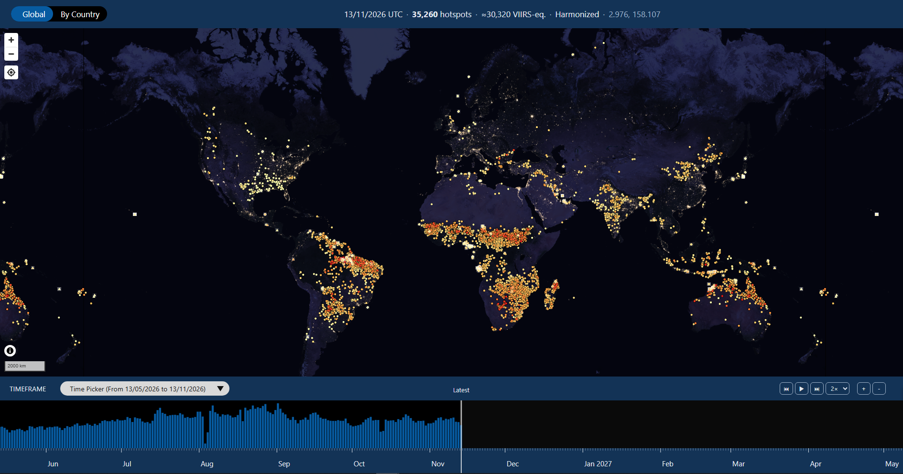
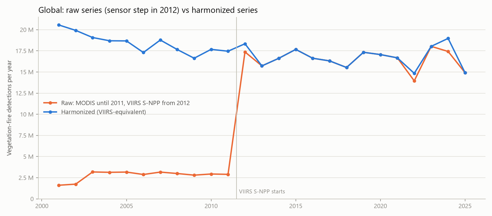
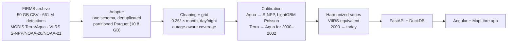
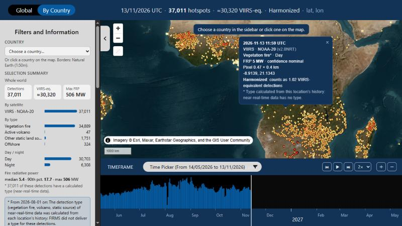
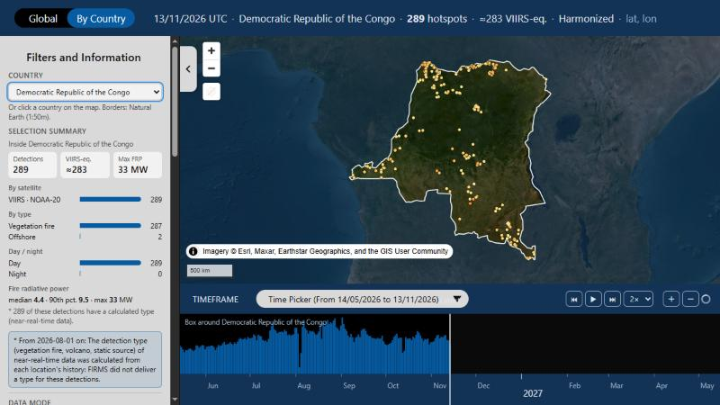
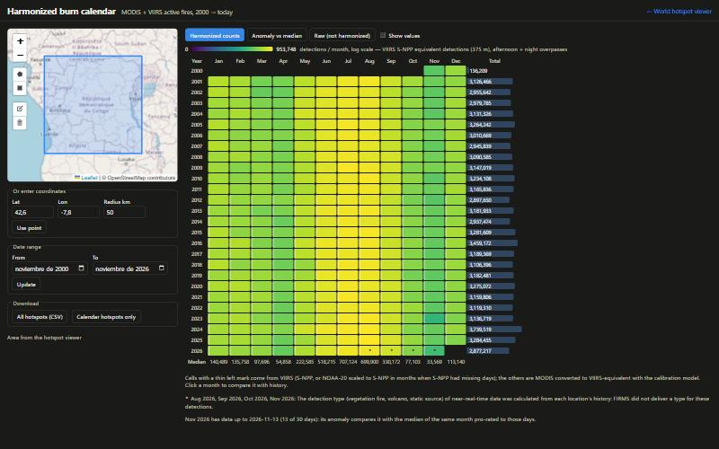
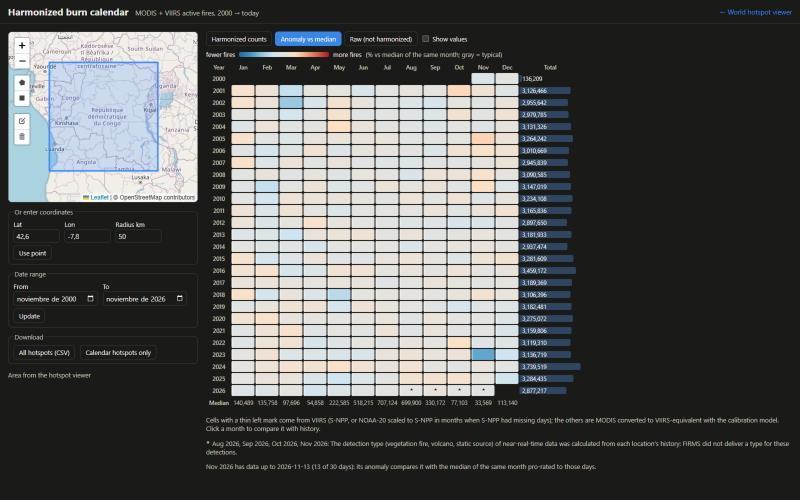

<div align="center">

# Kaji Hotspot Atlas

**One harmonized record of the planet’s fires, from 2000 to today.**
MODIS and VIIRS active-fire detections, made comparable in a single VIIRS-equivalent series.

[](https://kaji-department.web.app)


*NASA Space Apps Challenge 2026*



</div>

---

## The problem

MODIS (on Terra and Aqua) has watched the Earth’s fires since **2000**, but it is reaching the end of its life. VIIRS
(on Suomi NPP, NOAA-20 and NOAA-21) replaces it with **375 m** pixels instead of 1 km, so it detects many more small
fires: over the same places and hours, S-NPP counts about **6× more** detections than Aqua.

Put the two records side by side and you get a fake jump in 2012. Trends, seasons and anomalies stop meaning anything.

## The solution

Hotspot Atlas calibrates MODIS to VIIRS so the sensor no longer matters, and serves the result in a web app.

<p align="center">
  
</p>

| Validation 2020–2021 (out of sample) | 1° block WAPE | Spearman | Global monthly R² | Total bias |
|---|---|---|---|---|
| Raw, no calibration | 0.844 | 0.809 | −5.216 | −84.4 % |
| One global ratio (day/night) | 0.331 | 0.808 | 0.862 | −2.0 % |
| **LightGBM, day/night (used)** | **0.225** | **0.847** | **0.909** | **−2.8 %** |

Full metrics, per latitude band and per period, are in [`docs/RESULTS.md`](docs/RESULTS.md).

## How it works



1. **Unify.** Every FIRMS file (standard and near-real-time processing, all five satellites) is converted into one
   internal schema and one hive-partitioned Parquet table, with duplicate days removed.
2. **Clean and grid.** Vegetation fires only for the calendar (volcanoes, gas flares and offshore sources go to their
   own layer), a confidence threshold, known eruptions excluded, and counts per 0.25° cell × month, day and night
   apart. Satellite outage days are tracked, so months with missing days become full-month equivalents.
3. **Calibrate.** **Aqua and S-NPP** cross the equator at the same time, so their only difference is the sensor.
   Separate day and night **LightGBM Poisson** models (3×3 neighbourhood, FRP, climatology) learn S-NPP counts from
   Aqua on **2012–2019** and are validated on **2020–2021**, right before the satellites’ orbits start to drift.
4. **Fill.** **Terra** covers 2000–2002 through a Terra → Aqua model. **NOAA-20 and NOAA-21** fill the months where
   S-NPP has missing days, and the period after its last data, scaled to S-NPP.
5. **Flag what is inferred.** Near-real-time detections come without a FIRMS type, so their type is inherited from
   each location’s history. The app and the CSV always mark these detections.

The data findings behind each rule are in [`docs/DATA.md`](docs/DATA.md) and [`docs/ANALYSIS.md`](docs/ANALYSIS.md).

## The app

| | |
|---|---|
|  |  |
| **World viewer.** Any day, week or month since 2000 on a timeline, with filters (source, type, confidence, day/night, FRP, hour) and a live summary. Each detection shows its VIIRS-equivalent weight. | **By Country.** Pick a country (Natural Earth borders) to see its detections and summary. |
|  |  |
| **Burn calendar.** Draw an area or enter coordinates: years × months in VIIRS-equivalent counts, with a colour-blind-safe ramp. | **Anomalies.** Each month against the median of the same month across years, plus CSV downloads of the detections. |

## Run it locally

Requirements: Python 3.12, Node.js, and the raw FIRMS CSVs in `data/MODIS`, `data/SV_C2`, `data/J1V_C2`,
`data/J2V_C2` (from the [FIRMS archive download](https://firms.modaps.eosdis.nasa.gov/download/)).

```powershell
py -3.12 -m venv .venv
.venv\Scripts\python -m pip install -r requirements.txt

# data pipeline (≈ 2 h in total on a 16 GB laptop)
.venv\Scripts\python -m pipeline.adapter convert      # raw CSV -> Parquet detections table
.venv\Scripts\python -m pipeline.aggregate build      # cleaning + 0.25° × month grid
.venv\Scripts\python -m pipeline.calibrate run        # calibration, validation, harmonized series
.venv\Scripts\python -m pipeline.publish build        # small serving tables for the API

# web app + API
cd web; npm ci; npx ng build; cd ..
.venv\Scripts\python -m uvicorn api.main:app --port 8000
```

Open <http://localhost:8000> for the viewer and <http://localhost:8000/calendar> for the calendar. API docs are at
`/docs`. For front-end work with live reload, run `npx ng serve` in `web/` (it proxies `/api` to port 8000).

## Deployment

| Piece | Where |
|---|---|
| API | Google **Cloud Run** (container from the `Dockerfile`: code and small serving tables only) |
| Detections | Google **Cloud Storage** bucket, mounted read-only into the container |
| Web app | **Firebase Hosting** (static Angular build) |

Paths are set with environment variables (`FIRE_PROCESSED_DIR`, `FIRE_HOTSPOTS_DIR`, `FIRE_TMP_DIR`, `CORS_ORIGINS`),
so the same code runs locally and in the cloud.

## Repository layout

```
pipeline/   adapter, cleaning + aggregation, calibration, publishing (Python, DuckDB, LightGBM)
api/        FastAPI app: viewer, calendar, anomaly and CSV endpoints
web/        Angular + MapLibre front end (palette in web/src/theme.css)
analysis/   exploratory figures of the raw record
docs/       data notes, analysis, calibration results and figures
data/       raw FIRMS CSVs and processed outputs (not in git)
```

## Data and credits

- Active-fire data: **NASA FIRMS** (Fire Information for Resource Management System): MODIS Collection 6.1 (MCD14ML)
  and VIIRS 375 m Collection 2 (VNP14IMGT, VJ114IMGT, VJ214IMGTDL), standard and near-real-time processing.
- Country borders: [Natural Earth](https://www.naturalearthdata.com/) 1:50m (public domain).
- Base maps: Esri World Imagery, OpenStreetMap contributors, NASA GIBS Black Marble.

This is an independent project and is not affiliated with or endorsed by NASA.

## Use of SI tools

As the Space Apps rules require: the solution idea and every decision are mine. **Claude Code** was used as a coding assistant to implement, run and document parts of the pipeline. Source files written with it carry an `SI-assisted` header comment.