# Fire history analysis — what the data shows

Analysis of the global FIRMS hot-spot record, 2000-11-01 → 2026-11-13: **~661 million detections** from 5 satellites.
Every number comes from the pipeline inventory (`data/processed/inventory/`), so no new pass over the 53 GB of raw CSV was needed.

**How to read the figures**
- Unless a figure says otherwise, counts are **raw (not harmonized)**. The MODIS and VIIRS satellites are always shown separately.
- Default cleaning: `type = 0` (vegetation fire), MODIS confidence ≥ 30, VIIRS confidence nominal/high.
- Long-term trends use one satellite at a time: **Aqua 2003–2021** (before its orbit drift) or **S-NPP 2012–2025**.
- Figures in `analysis/figures/`, tables in `analysis/tables/`, scripts in `analysis/scripts/`. Re-run with:
  `.venv\Scripts\python analysis\scripts\build_cache.py`, then each `b*.py` script.
- `[SLIDE]` marks the best candidates for the presentation.

---

## Top findings (TL;DR)

1. **The raw record has a step in 2012.** VIIRS detects **~5x more hot spots than MODIS by day and ~30x more at night** for the same fires. That is why we need harmonization.
2. **The ratio between sensors is very stable from year to year** (S-NPP/Aqua by day = 4.7–5.2 every year from 2012 to 2025). A calibration should hold well over time, *as long as day and night are calibrated separately*.
3. **The MODIS orbits are drifting, and you can see it in the data.** From 2022 Terra's day counts fall by half relative to Aqua, and Terra's night share doubles. Aqua's night counts fall from 2025. **Do not trust MODIS-only trends after ~2021.**
4. **The three VIIRS satellites agree within 2–7%** (NOAA-20 ≈ 0.98 × S-NPP, NOAA-21 ≈ 0.94 × S-NPP by day). VIIRS can continue the series after S-NPP with only a small adjustment.
5. **The world burns on a fixed calendar.** Every year the main peak is in **Jul–Sep (~37% of all hot spots)**, driven by the southern-hemisphere tropics, with a second, smaller peak in Dec–Mar (northern savannas).
6. **Two thirds of all hot spots are between 20°S and 10°N** (African and South American savannas).
7. **Fire activity is not increasing globally.** Aqua shows a **significant decline of ~1.2%/year (2003–2021, about −20% over 19 years)**, consistent with the published savanna/cropland decline. The far north (60–70°N) is the only band trending up. S-NPP 2012–2025 is flat.
8. **Record months are recent:** May–Aug 2024, May and Oct 2023, Jul 2021 and Jun 2012 were all +30% or more above normal globally. 2026 has been **below normal from January to June**, and close to normal in Jul–Oct.

---

## B1. What data we have, and how clean it is

**Data:** all 58 files, all satellites. **Satellites in this section:** all five.

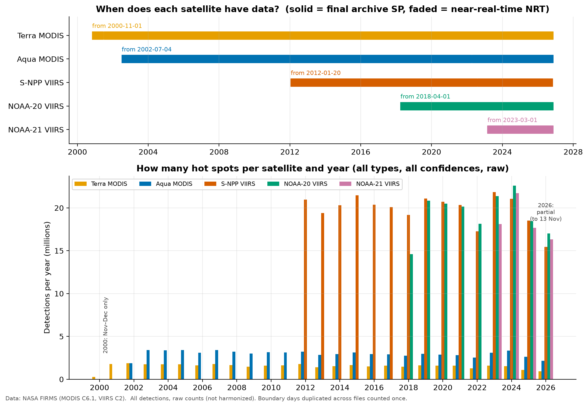
`analysis/figures/b1_coverage_timeline.png` **[SLIDE: "what data we used"]**

- **5 satellites:** Terra (from 2000-11), Aqua (2002-07), S-NPP (2012-01), NOAA-20 (2018-04) and NOAA-21 (2023-03).
  The final archive (SP) runs to Jul/Aug 2026, then near-real-time data (NRT) runs to 13 Nov 2026.
- **Typical yearly volume:** a VIIRS satellite records **~15–22 M detections per year**, Aqua ~3 M and Terra ~1.6 M.
- **Missing days are few** (`analysis/tables/b1_missing_days.csv`):

  | Satellite | Missing days | Main gaps |
  |---|---|---|
  | Terra | 57 | 2001-06-16 → 07-02, 2022-10-11 → 22 |
  | Aqua | 26 | **2022-04-01 → 16** |
  | S-NPP | 49 | 2022-07-27 → 08-10, several in 2024 and 2026 |
  | NOAA-20 | 6 | — |
  | NOAA-21 | 2 | — |

  The figures below use *detections per day with data*, so these gaps do not look like quiet fire months.
- **Duplicated days in the files:** 2014-01-22 and 2015-01-23 appear **complete in two consecutive files** (Terra, Aqua and S-NPP). Here they are counted once.

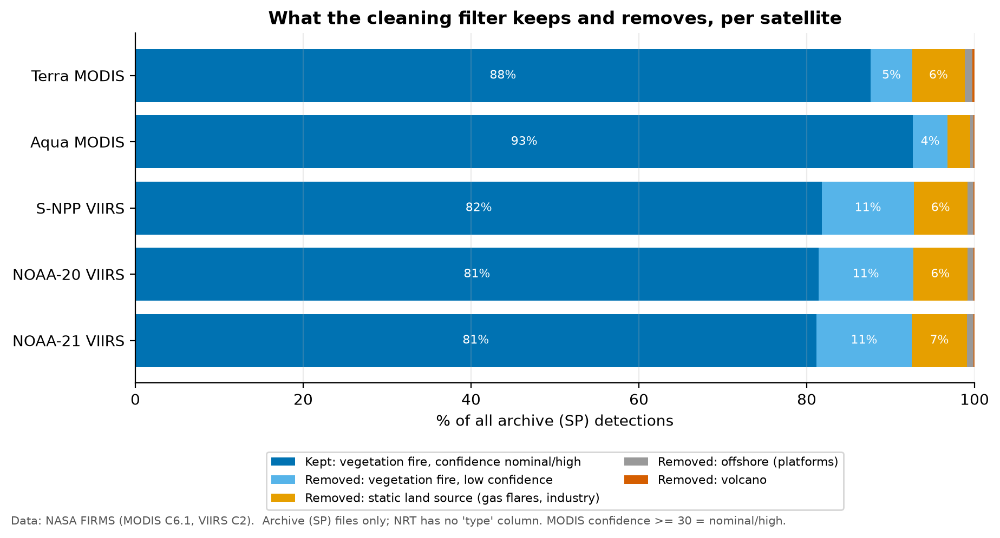
`analysis/figures/b1_cleaning_breakdown.png`

- **The cleaning keeps 88% of Terra, 93% of Aqua and 81–82% of VIIRS detections.**
- VIIRS loses more because 11% of its detections are low-confidence, against 4–5% for MODIS. It also flags more static sources (6–7%).
- **Volcanoes are tiny** (<0.3%). Gas flares and industry are the main non-vegetation source.

**For the pipeline agent:**
- Deduplicate 2014-01-22 and 2015-01-23. The whole day is repeated, not split.
- Account for Aqua's April 2022 gap when calibrating.

---

## B2. Why harmonization is needed: the sensor step and orbit drift

**Data:** archive (SP), cleaned. Ratios only use days where both satellites have data.

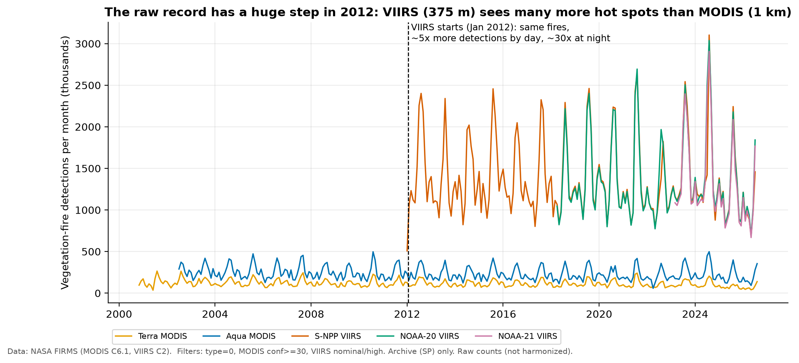
`analysis/figures/b2_raw_step.png` **[SLIDE: "the problem"]**

- Plotted naively, the record shows a **5–6x jump in January 2012**. The planet did not start burning more: a sharper sensor came online.

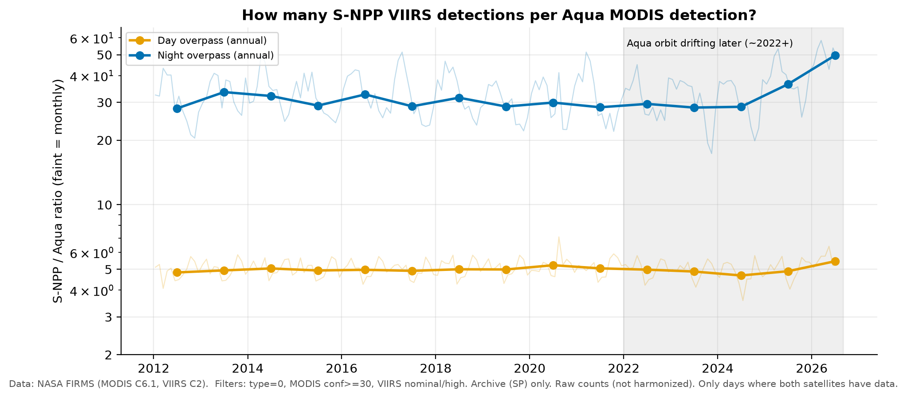
`analysis/figures/b2_viirs_aqua_ratio.png` **[SLIDE]**

- **S-NPP / Aqua by day: 4.7–5.2 every year, 2012–2025.** This is very stable, which is good news for calibration.
- **S-NPP / Aqua at night: ~28–33.** This is higher than the 15–20 found during preparation for Spain and Brazil. The night ratio depends on the region, so **calibrate day and night separately, and by region**.
- **The ratio jumps in 2025–2026** (night 36 → 50, day 5.5). This is Aqua's orbit drifting later, so Aqua misses more fires. **Do not train the calibration on 2022+.** This confirms the plan to validate on 2020–2021 only.

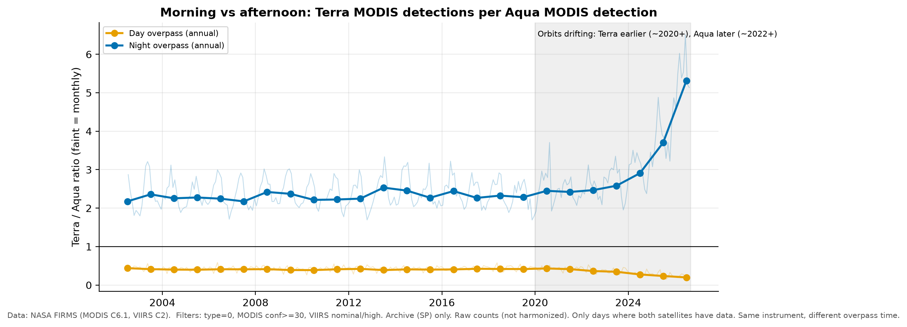
`analysis/figures/b2_terra_aqua_ratio.png`

- Same instrument, different overpass time. **Terra (10:30) sees only ~0.41 of Aqua's (13:30) daytime fires**, because fires peak in the early afternoon. **At night Terra (22:30) sees ~2.3x more than Aqua (01:30)**, because fires die down after midnight.
- From 2022 the day ratio falls (0.41 → 0.20) and the night ratio climbs (2.3 → 5.3). That is **orbit drift**. A Terra→Aqua gap-fill model must be trained on 2002–2019.

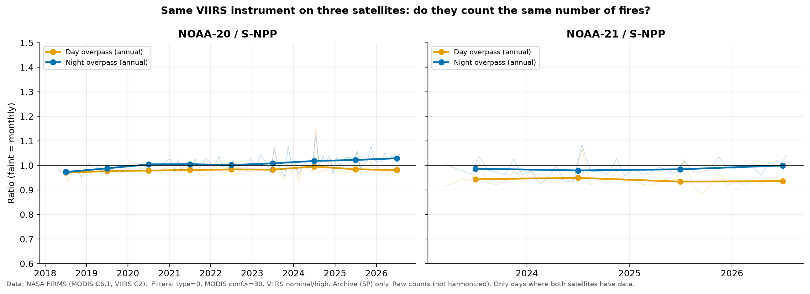
`analysis/figures/b2_three_viirs.png`

- **NOAA-20 ≈ 0.98 × S-NPP by day and 0.97–1.03 at night.** **NOAA-21 ≈ 0.94 by day and 0.98–1.00 at night.** Both are steady over time.
- The three VIIRS satellites are practically interchangeable. A per-satellite factor (≈ 1.02 for NOAA-20, ≈ 1.06 for NOAA-21 by day) would make them continue the S-NPP series.

**For the pipeline agent:**
- Day/night calibration is mandatory (the factors are ~5 by day and ~30 at night).
- Train on 2012–2019, validate on 2020–2021. Treat 2022+ as drift-affected.
- NOAA-20 and NOAA-21 can extend S-NPP with a simple scale factor.

---

## B3. Seasonality: the global burning calendar

**Data:** Aqua 2003–2026 and S-NPP 2012–2026, archive (SP), cleaned. Each satellite has its own colour scale.

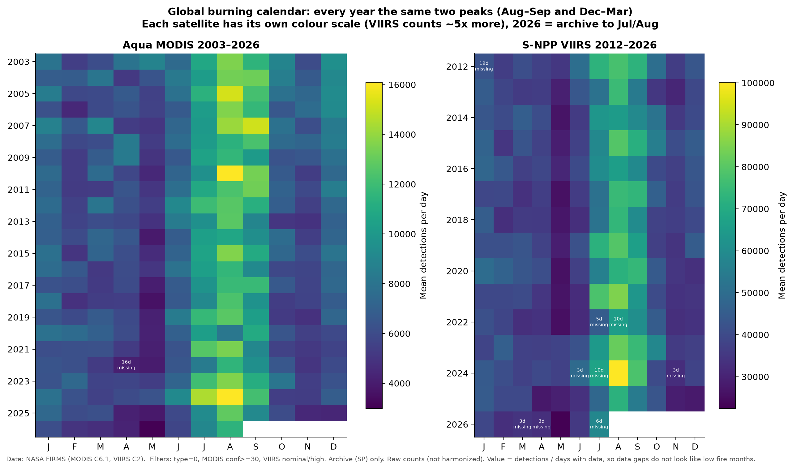
`analysis/figures/b3_calendar_heatmap.png` **[SLIDE: "the burning calendar" — what the app shows]**

- The same pattern repeats every year: **a strong band in Jul–Sep** and a weaker one in Dec–Mar. **May is always the quietest month.**
- **Bright cells are the record months:** Aug 2010 (Russia and Brazil), Aug–Sep 2007, Aug 2024 and Jul–Aug 2023/2024.

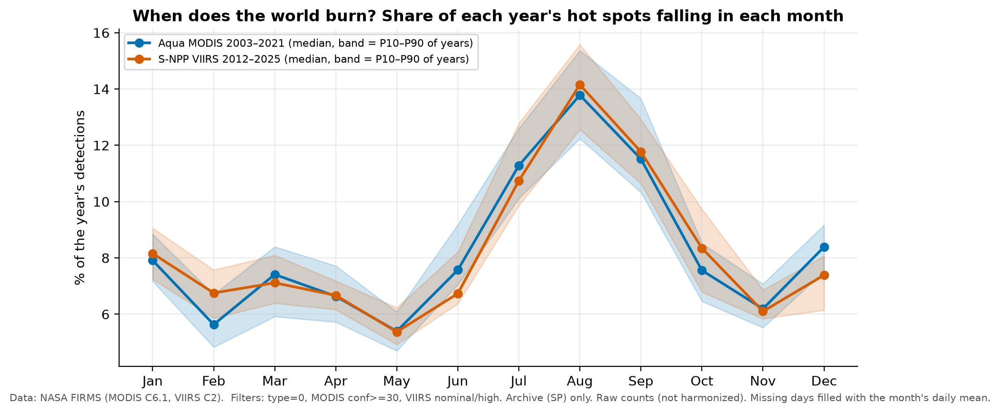
`analysis/figures/b3_seasonal_profile.png`

- **August alone holds ~14% of the year's hot spots**, and Jul+Aug+Sep together ~37%. May holds only ~5%.
- **Aqua and S-NPP give almost the same seasonal shape** (all months within ±1.2 points). The sensors differ in *how many* fires they count, not in *when* fires happen. This supports a simple calibration factor.

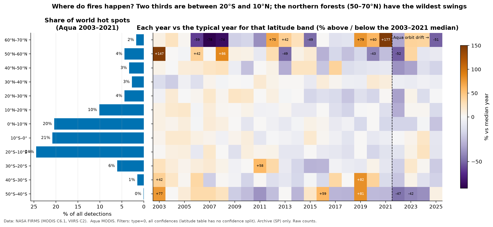
`analysis/figures/b3_latitude_bands.png`

- **20°S–10°N holds 65% of all hot spots** (20°S–10°S alone has 24%: southern African and Brazilian savannas). Everything north of 40°N is only ~9%.
- **The northern forests have the most extreme years:** 50–60°N in 2003 (+147%, Siberia) and 2008 (+86%); 60–70°N in 2021 (+177%, Yakutia), 2019 (+79%) and 2020 (+60%).
- **Southern mid-latitudes:** 30–50°S were +80% in 2019. Australia's "Black Summer" started in late 2019.
- The tropics rarely deviate more than ±20%. They burn every year like clockwork.

---

## B4. Long-term trends

**Data:** Aqua 2003–2021 and S-NPP 2012–2025, archive (SP), cleaned. Trend test: Mann–Kendall with Sen's slope.

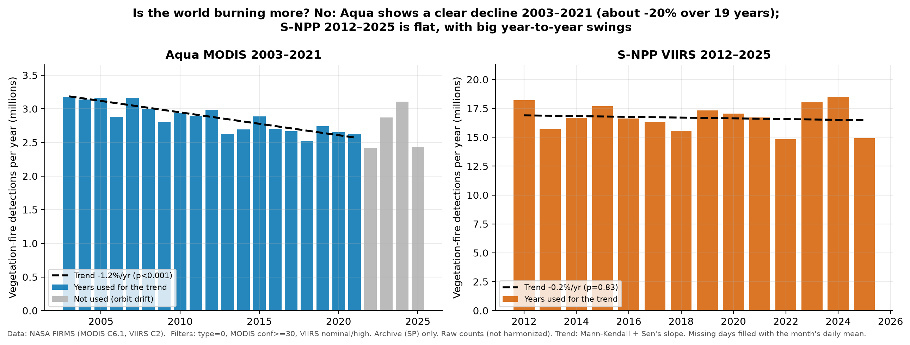
`analysis/figures/b4_global_annual_trend.png` **[SLIDE]**

- **Aqua 2003–2021: −1.2% per year, highly significant (p < 0.001)**, from ~3.2 M to ~2.6 M detections per year.
- **S-NPP 2012–2025: no trend** (−0.2%/yr, p = 0.83). Big swings between years: 2022 was low, and 2023–2024 were among the highest in its record.
- The Aqua decline agrees with the published finding that **global burned area fell, driven by savanna and cropland changes** (Andela et al., 2017, *Science*). Hot-spot counts are not burned area, but the direction matches.

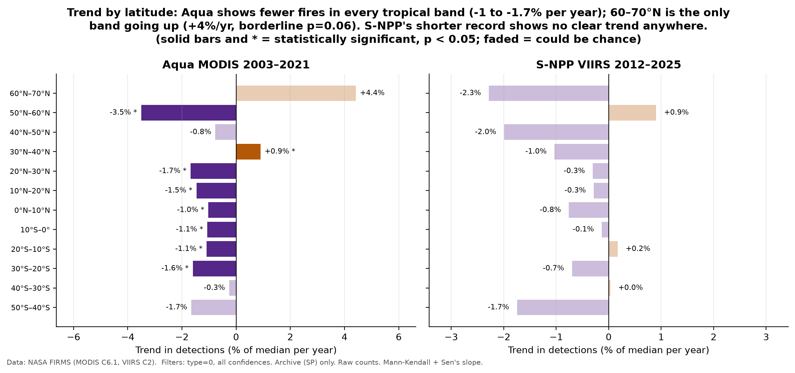
`analysis/figures/b4_latband_trends.png`

- **Aqua: every band from 30°S to 30°N is falling** (−1.0 to −1.7% per year, all significant). The decline is a tropical savanna story.
- **60–70°N is the only band going up (+4.4%/yr, p = 0.06, borderline).** 30–40°N is slightly up (+0.9%/yr). 50–60°N is down (−3.5%/yr), mostly because 2003 and 2008 were extreme years early in the record.
- **S-NPP shows no significant trend in any band.** 14 years is short, given how much fire varies from year to year.

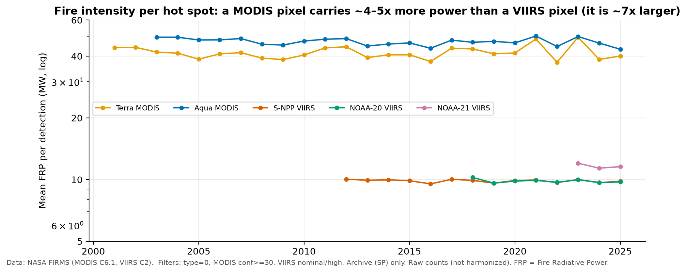
`analysis/figures/b4_frp_per_detection.png`

- **Mean fire power (FRP) per detection: ~47 MW for Aqua, ~42 for Terra, ~10 for VIIRS.** A MODIS pixel is about 7x larger, so each detection carries more fire.
- Mean FRP is **flat over time for every satellite**. There is no sign that individual detections are getting more intense globally.

---

## B5. Anomalies: which months were unusual, and an app preview

**Data:** S-NPP 2012–2026, cleaned. Single satellite, so no harmonization is needed.

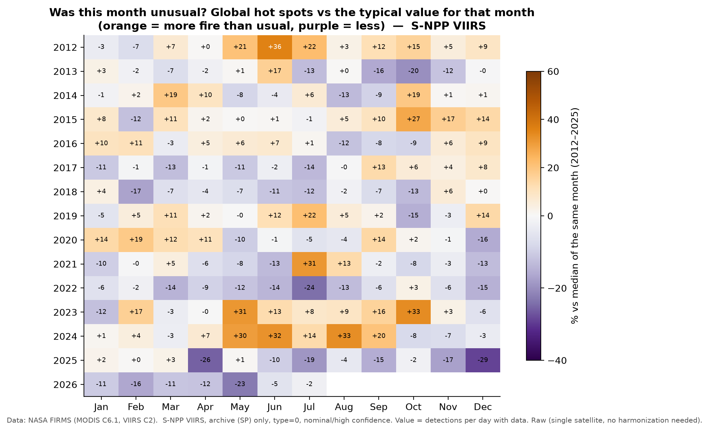
`analysis/figures/b5_monthly_anomaly_heatmap.png` **[SLIDE: anomaly view with a colourblind-safe diverging ramp]**

- **Top positive months globally** (`analysis/tables/b5_top_anomalous_months.csv`):
  - Jun 2012 (+36%)
  - Oct 2023 (+33%)
  - Aug 2024 (+33%)
  - Jun 2024 (+32%)
  - Jul 2021 (+31%, Siberia and North America)
  - May 2023 (+31%, Canada's record season starts)
  - May 2024 (+30%)
  - Oct 2015 (+27%, Indonesia El Niño peat fires)
- **2023–2024 were the most anomalous run** in the S-NPP record: almost every month from May 2023 to Sep 2024 was above normal.
- **Most negative months:** Dec 2025 (−29%), Apr 2025 (−26%), Jul 2022 (−24%) and May 2026 (−23%).
- This is the global picture. Regional case studies (Canada 2023, Amazon 2019/2024, Australia 2019–20) need the gridded Parquet from the pipeline (see "Next steps").

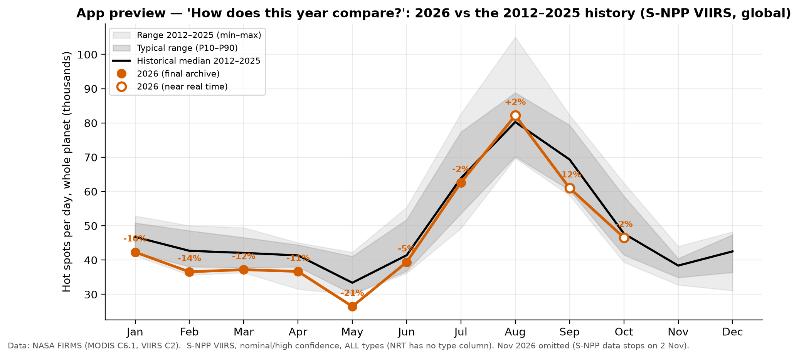
`analysis/figures/b5_current_year_vs_history.png` **[SLIDE: prototype of the app's "current month vs historical median"]**

- **2026 so far:**
  - **Jan–Jun were 5–21% below the 2012–2025 median.** May (−21%) was close to the record low.
  - Jul–Oct were back to normal (−12% to +2%).
- Caveat: Aug–Oct come from near-real-time data, which has no `type` column. For a fair comparison this figure **keeps all types** in both history and 2026, so ~6% of the counts are static sources in both.

---

## B6. Day vs night

**Data:** archive (SP), cleaned.

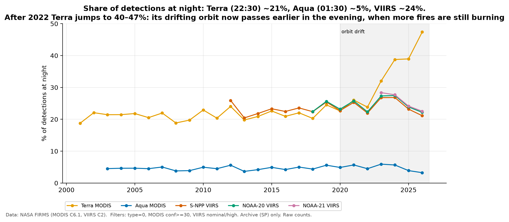
`analysis/figures/b6_night_share.png`

- **Share of detections at night:** Aqua (01:30) **~5%**, Terra (22:30) **~21%**, VIIRS **~22–27%**. VIIRS sees far more small, cool night fires.
- **Terra's night share jumps to 39–47% in 2024–2026.** Its drifting orbit now passes earlier in the evening, when more fires are still burning. This is a clear drift signature, not a change in fire behaviour.
- Terra's 10:30/22:30 slot catches fires that the afternoon satellites (Aqua and VIIRS) see at a different stage. Once Terra ends, nothing at NASA/NOAA replaces that morning slot. Sentinel-3 SLSTR (~10:00) is a candidate for future work.

---

## B8. Static sources and volcanoes (side story)

**Data:** S-NPP 2012–2025, archive (SP), all confidences, `type` 1/2/3.

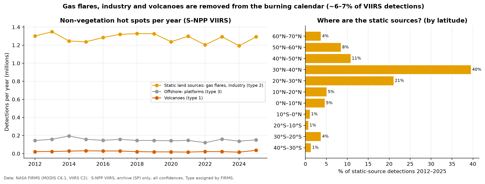
`analysis/figures/b8_static_sources.png`

- **~1.2–1.35 M static-source detections per year** (gas flares, refineries, industry), roughly constant since 2012. Offshore platforms add ~0.15 M per year and volcanoes ~0.02–0.04 M.
- **61% of static sources are between 20°N and 40°N** (Middle East, North Africa, the Permian basin). Another ~12% are at 50–70°N (West Siberian oil fields).
- They are steady all year, so they would add a flat "fake fire" floor to the calendar. That is why they are removed (`type = 0` only).

---

## Not possible yet (needs the gridded Parquet from the pipeline)

The current inventory has no lat/lon grid and no acquisition times. These analyses wait for the pipeline's Parquet (step 4):
- **Maps:** peak fire month per cell, fire season length, per-cell trend (Mann–Kendall), VIIRS/Aqua ratio per cell for calibration.
- **Regional case studies:** Canada 2023, Amazon 2019/2020/2024, Australia 2019–20, Indonesia 2015, Spain, La Palma 2021.
- **Median local overpass time per satellite and year** (direct measurement of orbit drift).
- **Top FRP events** and the share of total FRP from the top 1% of detections.

## Recommended slide figures, in order
1. `b1_coverage_timeline.png`: what data we used
2. `b2_raw_step.png`: the problem (2012 step)
3. `b2_viirs_aqua_ratio.png`: the step is stable, so it can be calibrated (day ≠ night)
4. `b2_terra_aqua_ratio.png` or `b6_night_share.png`: orbit drift, and why 2022+ is handled separately
5. `b3_calendar_heatmap.png`: the burning calendar
6. `b4_global_annual_trend.png`: is the world burning more?
7. `b5_monthly_anomaly_heatmap.png`: anomalies
8. `b5_current_year_vs_history.png`: app preview (current year vs history)
